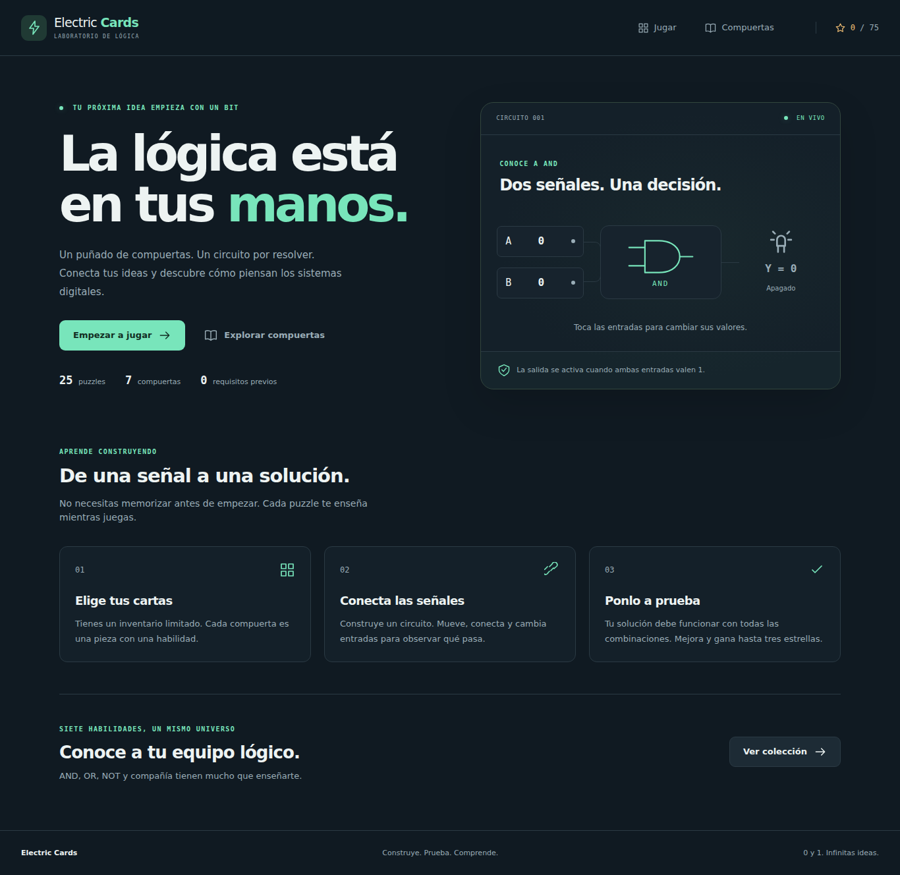
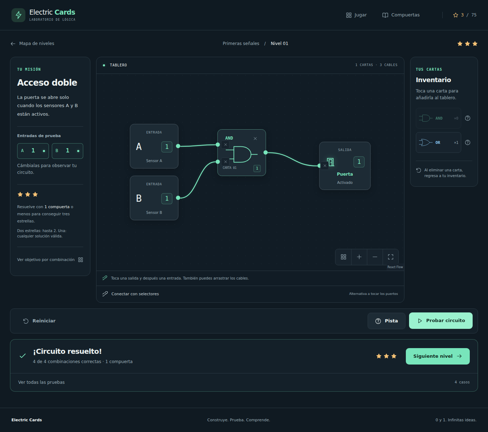

# Electric Cards

Juego web educativo de lógica digital. Construye un circuito con un inventario
limitado de compuertas y consigue que sus salidas cumplan el objetivo en **todas
las combinaciones y secuencias de prueba**. Interfaz en español para PC, tablet y celular.



## Qué incluye

- Cinco etapas: 40 niveles regulares y cinco retos que permiten saltar etapas.
- AND, OR, NOT, NAND, NOR, XOR, XNOR, CLOCK y flip-flops D y T.
- Editor de nodos: añadir, mover, conectar, desconectar y eliminar cartas.
- Conexión por arrastre, dos toques.
- Vista previa de señales 0/1; conexiones incompletas muestran `?`.
- Rechazo de ciclos, puertos ocupados y conexiones inválidas.
- LEDs, puertas, banderas, alarmas y motores como salidas binarias.
- Validación exhaustiva con resultados de cada combinación.
- Compuertas básicas desde el inicio; CLOCK, DFF y TFF al llegar a la etapa 4.
- Optimización y progreso guardado: los niveles omitidos siguen disponibles para practicar.
- Ventana de éxito con el componente obtenido y botón para el siguiente nivel.
- Reloj manual o automático, memoria y comprobación de secuencias temporales.
- Guardado local del progreso y de los circuitos en construcción.
- Colección educativa con personajes, símbolos, expresiones, tablas de verdad
  y simuladores interactivos para los diez componentes.
- Instrucciones para agentes, documentación técnica y CI para GitHub Actions.

No necesita backend ni cuenta. El progreso se guarda en este navegador y no se
sincroniza entre dispositivos.

## Ejecutar

Requiere Node.js 22.12+; se recomienda Node.js 24.

```sh
git clone https://github.com/OsvaldoVar/electric-cards.git
cd electric-cards
npm ci
npm run dev
```

El repositorio es privado: GitHub debe autorizar tu cuenta para clonarlo.

Abre la dirección mostrada por Vite. Para probar desde un celular de tu red,
utiliza la dirección de red que muestra el servidor. El firewall del equipo
debe permitir el puerto de desarrollo.

```sh
npm run build
npm run preview
```

`dist/` contiene la versión estática de producción. El servidor debe devolver
`index.html` al abrir rutas como `/puzzle/1`. `vercel.json` incluye las reglas
de SPA para importar el repositorio en Vercel. No requiere variables secretas.

## Cómo jugar

1. Abre **Jugar** y elige un nivel disponible.
2. Lee la misión y observa el inventario.
3. Toca una carta para añadirla. Arrástrala dentro del tablero para colocarla.
4. Conecta una salida con una entrada: arrastra el cable o toca primero el
   puerto de salida y después el de entrada.
5. Cambia las entradas para explorar el comportamiento del circuito.
6. Pulsa **Probar circuito**. Solo completas el nivel al pasar todos los casos.
7. Revisa las combinaciones fallidas, usa una pista o mejora tu solución.

Cualquier solución correcta completa el nivel. Si utiliza más compuertas que
el objetivo de optimización, aparece información azul indicando que se puede
resolver con menos compuertas. No se penaliza pedir pistas. Eliminar una carta
devuelve su unidad al inventario. Reiniciar vacía el tablero y conserva los
niveles completados.
El botón **Ajustar tablero** recupera los nodos después de moverlos o hacer zoom.
**Organizar tablero** distribuye las cartas para la pantalla actual: de
izquierda a derecha en PC y de arriba hacia abajo en celular.



## Stack

React + Vite, JavaScript, CSS, React Router, @xyflow/react, Context/useReducer,
localStorage, Vitest, React Testing Library, Playwright, ESLint y Prettier.
El lockfile fija las versiones instaladas. Los símbolos y personajes son SVG
del repositorio y no dependen de servicios de imágenes o fuentes externas.

## Verificar

```sh
npm run lint
npm run format:check
npm run test
npm run build
npx playwright install chromium
npm run test:e2e
```

Playwright prueba la build de producción; ejecuta `npm run build` primero.
`npm run test:watch` activa el modo interactivo de Vitest. CI ejecuta las mismas
comprobaciones y conserva los informes de Playwright si hay un fallo.
La verificación de esta versión está registrada en [docs/TESTING.md](docs/TESTING.md).

## Estructura

```text
src/
  components/    Editor, cartas, tablas, objetivos y resultados
  context/       Proveedor y reducer del juego
  data/          Compuertas, mundos y niveles declarativos
  engine/        Operaciones, DAG, evaluación y validación pura
  hooks/         Coordinación del puzzle y progreso
  pages/         Rutas cargadas bajo demanda
  services/      Persistencia versionada y saneamiento de borradores
  styles/        Variables, estilos globales y reglas responsive
tests/
  engine/        Tablas, grafos y soluciones de los 45 circuitos
  fixtures/      Circuitos de referencia independientes
  e2e/           Recorridos de escritorio y touch
docs/            Especificación, arquitectura, contenido y QA
```

Lee [AGENTS.md](AGENTS.md) y todos los archivos de `docs/` antes de modificar.
La lógica booleana pertenece al motor; las vistas no calculan operaciones.
Para añadir contenido, sigue [docs/LEVELS.md](docs/LEVELS.md).

## Documentación

| Archivo                                      | Contenido                                      |
| -------------------------------------------- | ---------------------------------------------- |
| [AGENTS.md](AGENTS.md)                       | Reglas para trabajar en el proyecto            |
| [docs/SPEC.md](docs/SPEC.md)                 | Alcance, pantallas y criterios de aceptación   |
| [docs/ARCHITECTURE.md](docs/ARCHITECTURE.md) | Motor, contratos, estado y decisiones técnicas |
| [docs/LEVELS.md](docs/LEVELS.md)             | Formato y creación de nuevos niveles           |
| [docs/UI.md](docs/UI.md)                     | Diseño responsive e interacción accesible      |
| [docs/TESTING.md](docs/TESTING.md)           | Cómo verificar y resultados de QA              |
| [docs/DEPLOYMENT.md](docs/DEPLOYMENT.md)     | Ejecución y publicación en Vercel              |
| [docs/ROADMAP.md](docs/ROADMAP.md)           | Trabajo completado y siguientes mejoras        |

## Alcance y próximos pasos

La aplicación trabaja con circuitos combinacionales acíclicos y señales 0/1.
No modela electrónica analógica, voltajes, tiempos de propagación,
microcontroladores ni circuitos de realimentación.

La siguiente iteración puede añadir exportación/importación de progreso,
un tutorial guiado y un editor de niveles que produzca el mismo formato de
datos. Antes de una entrega definitiva, conviene completar las comprobaciones
en Safari, Firefox y celulares físicos indicadas en el registro de QA.

Diseñado para el proyecto académico de compuertas lógicas de FCC-BUAP.

## Relojes y memoria

El juego comienza con AND. Completar 1 desbloquea OR; 2, NOT; 5, NAND; 6, NOR;
10, XOR; 11, XNOR; 25, CLOCK; 27, DFF; y 31, TFF. Las fichas bloqueadas indican
el nivel requerido. Los componentes desbloqueados siguen respetando el
inventario de cada reto.

Los niveles 26–35 comprueban secuencias de señales. Usa **Avanzar reloj** para
alternar CLK entre 0 y 1, **Iniciar reloj** para avanzar automáticamente cada
segundo y **Pausar reloj** para detenerlo. DFF guarda D en el flanco 0 → 1;
TFF alterna Q cuando T vale 1 en ese flanco. Q se conserva entre flancos.
**Reiniciar memoria** pone CLK y los registros en 0 sin vaciar el circuito.
El circuito y el progreso se guardan; al recargar, la memoria vuelve a 0.

## Recorrido por etapas

| Etapa | Contenido                                         | Reto de salto                                            |
| ----- | ------------------------------------------------- | -------------------------------------------------------- |
| 1     | Una o dos compuertas básicas del mismo tipo       | Tres AND y cuatro sensores                               |
| 2     | Dos a cuatro compuertas de distintos tipos        | Cinco compuertas, mayoría y su negación                  |
| 3     | Optimización, señales compartidas, NAND y sumador | Seis NAND y tres salidas                                 |
| 4     | Reloj, flancos, flip-flops D/T y registros        | Cinco componentes, dato invertido, retraso y alternancia |
| 5     | Lógica combinacional, reloj y memoria juntos      | Ocho componentes, selector y tres memorias               |

El reto está disponible desde la entrada de su etapa. Aprobar todos los niveles
regulares o aprobar el reto acredita la etapa y abre la siguiente. Saltar una
etapa no marca sus niveles como resueltos: quedan disponibles para practicar.
El reto de la etapa 5 acredita el recorrido completo. Los componentes del reloj
y la memoria se desbloquean al entrar a la etapa 4, también por saltos.

Los identificadores anteriores se conservan para mantener las finalizaciones.
El orden pedagógico está definido por etapa y puede diferir del número del nivel.
Los circuitos guardados siguen cargándose si cumplen el inventario de su nivel.
